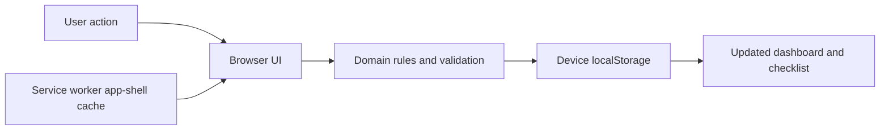

# Job Application Checklist

A browser-only workspace for keeping job applications moving. Add an opportunity, complete its checklist, and keep deadlines and outstanding documents visible. No account, application backend, analytics, remote fonts, or runtime dependencies.

## Run locally

Requires Node.js 22 or newer (verified with Node 24.1.0). No dependency installation or compilation is needed.

```sh
git clone https://github.com/SadaqueKhanProjects/job-application-checklist.git
cd job-application-checklist
npm start
```

Open http://127.0.0.1:4173 in your browser. Use the same browser and address each time to access the same data. Keep the terminal running for first access. `Ctrl+C` stops the preview server; it only serves static files and never receives application data. An initial successful load caches the app for subsequent offline reloads in browsers supporting service workers on localhost or HTTPS. Opening `index.html` directly with `file://` is unsupported.

```sh
npm test
npm run check
```

The source is the release artifact. There is no bundling step, package download, dependency audit surface, or remote deployment configured. To serve it elsewhere later, use a dedicated HTTPS static origin and these same files.

## How it behaves

- Company, role, calendar deadline and HTTP(S) job link are required. Applications can be edited or deleted with confirmation.
- All seven checklist steps remain available at every stage. The first checked step starts progress. Checking Submit application marks an active application Submitted; unchecking it while Submitted returns it to In progress.
- Manually choosing Submitted, Interview or Offer checks Submit application and records the first submission time. Moving back to Not started or In progress clears that submission time and checkbox. Rejected preserves submission history when present.
- Due soon includes active applications due within seven calendar days **and overdue items**, ordered earliest first. Past deadlines are highlighted only for Not started and In progress applications. Deadlines use the device's local date, including today and tomorrow.
- Missing documents means an active application whose Tailor CV or Write cover letter step is incomplete. This version tracks completion, not files.
- Recently submitted shows the three latest recorded submissions, including ones that have moved into later stages. Status totals always count all applications; search and filters affect the checklist cards.

## Data and recovery

Applications belong to this browser's local storage at this origin under `job-application-checklist.v1`. Nothing is sent to an external service. Data is not encrypted or synced. Other users of the same browser profile can access it. Private browsing, clearing site data, changing ports/domains or using another browser can remove or hide it.

Export a backup downloads a versioned, readable JSON file to your browser's configured download location. Backup **import is not implemented in v1**; preserve exports for manual recovery or a future import feature. Do not treat browser storage as your only copy of important information.

Saving happens before a UI change is accepted. Failed writes keep the previous in-memory state and display a retry message. Unreadable or incompatible saved data blocks writes and preserves the original value; restore storage access or recover the original data before reloading. A second tab's storage changes refresh the list and close an open editor to reduce stale overwrites; simultaneous multi-tab writes are not transactional.

The versioned envelope is `{ version: 1, applications: [...] }`. Records contain ID, company, title, deadline (`YYYY-MM-DD`), link, status, seven checklist booleans, creation time and nullable submission time. Keep task ordering stable; future schema changes must validate and migrate existing records before writing. Never silently reset incompatible data.

## Structure

```text
index.html          Accessible app shell and modal forms
src/app.js          Rendering, interactions and persistence error feedback
src/domain.js       Checklist rules, date logic and storage validation
src/styles.css      Responsive desktop and mobile layouts
sw.js               Offline app-shell cache (no application data)
scripts/serve.js    Loopback-only static preview server
tests/              Domain/storage rules and static-server checks
```



## Verification and scope

Automated checks cover date/DST boundaries, URL validation, document eligibility, status/checklist transitions, storage round trips, invalid schema preservation, write failures and serving app assets. Desktop in-app browser checks covered creation, editing, overdue display, document completion, submission transitions, search, reload persistence and reloading with the server stopped. Native controls, visible labels, focus indicators, dialog focus handling and reduced-motion styling are included. Physical mobile devices and a full assistive-technology audit have not been tested.

V1 deliberately leaves reminders, document uploads, interview notes, CV libraries, analytics, calendar integrations, cross-device accounts and backup import for later. Source is maintained in the private GitHub repository. No paid service or deployment has been created.
