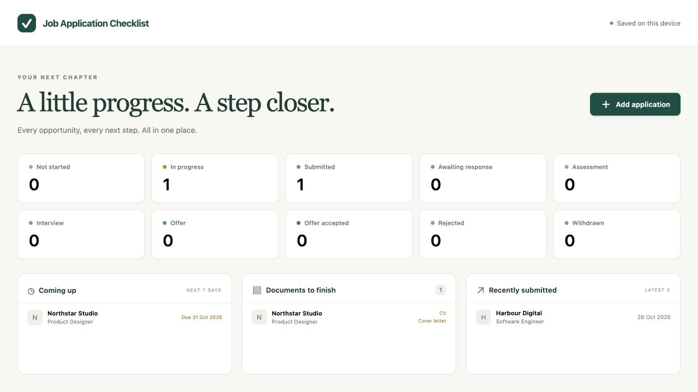
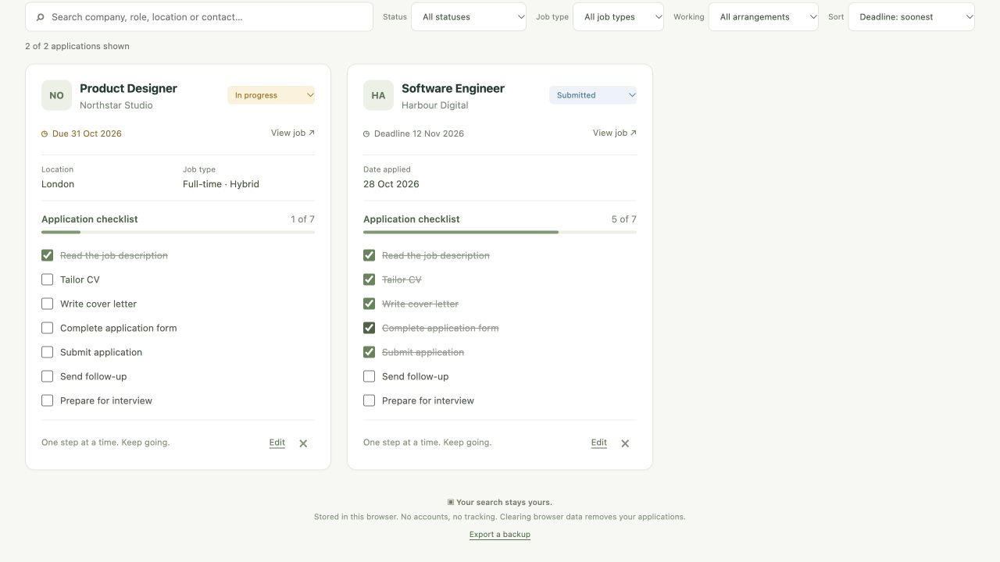
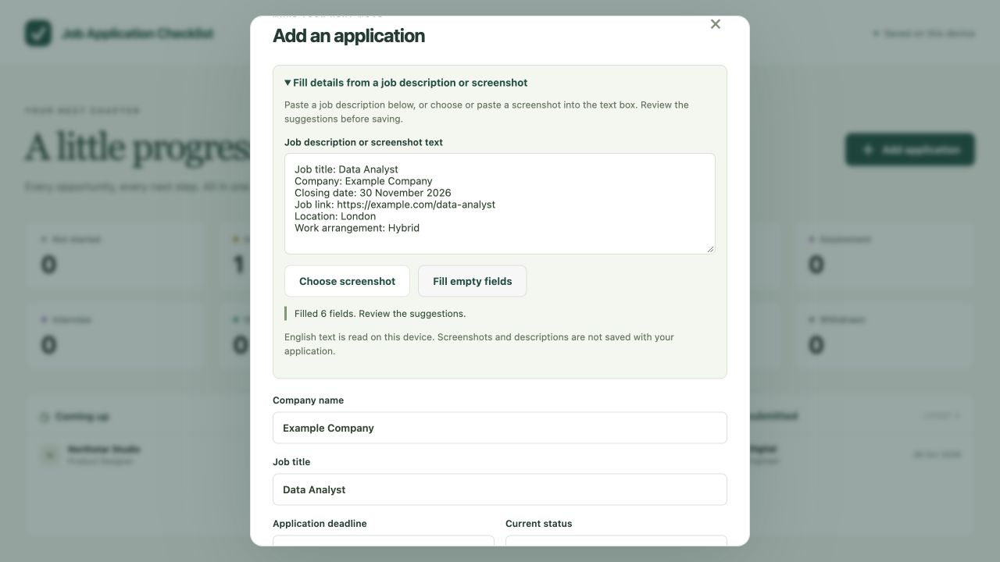
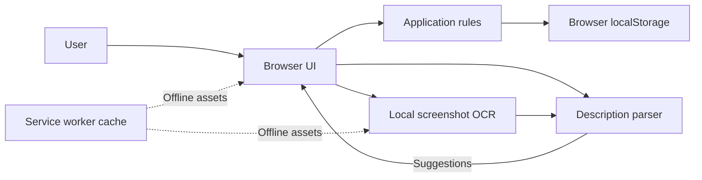

# Job Application Checklist

A browser-only app for tracking job opportunities, deadlines and application checklists. Select **Add application** to enter details or expand the job-description option to paste English text or choose a screenshot. Review suggested fields before saving.

## Screenshots

These screenshots use fictional example applications.

**Dashboard**



**Application checklists**



**Add from a job description**



## Run locally

Requires Node.js 22 or newer. No package installation or build is needed.

```sh
git clone https://github.com/SadaqueKhanProjects/job-application-checklist.git
cd job-application-checklist
npm start
```

Open [http://127.0.0.1:4173](http://127.0.0.1:4173). The terminal displays the local URL; leave it running and press `Ctrl+C` to stop. Use the same browser and address to see your saved applications. Opening `index.html` directly is unsupported.

## Commands

Run from the project directory:

| Command | Purpose |
| --- | --- |
| `npm start` | Start the local preview server. |
| `npm test` | Run the automated tests. |
| `npm run check` | Check JavaScript syntax. |

See [CONTRIBUTING.md](CONTRIBUTING.md) for branches, PRs and CI.

## Architecture



The UI validates and stores applications on the device. The local OCR engine reads screenshots; its text is parsed into suggestions that you can edit. The preview server serves static files only.

## Data and privacy

- Data stays in this browser profile and is not encrypted or synced. Clearing site data or using a different browser or address can remove or hide it.
- JSON export is unencrypted. **Import is not implemented**, so keep your own copy of important information.
- Screenshot OCR and text parsing run locally. The screenshot and description are not saved with the application. Review suggestions: the parser may miss fields or leave ambiguous dates blank.
- Offline use requires the browser to cache the app and OCR assets after a successful initial load on localhost or HTTPS. Close older app tabs and reload online after an upgrade.

See [Data and storage](docs/data-and-storage.md) for status behaviour, storage and migrations, and [OCR assets](vendor/ocr/README.md) for bundled components and licences.
