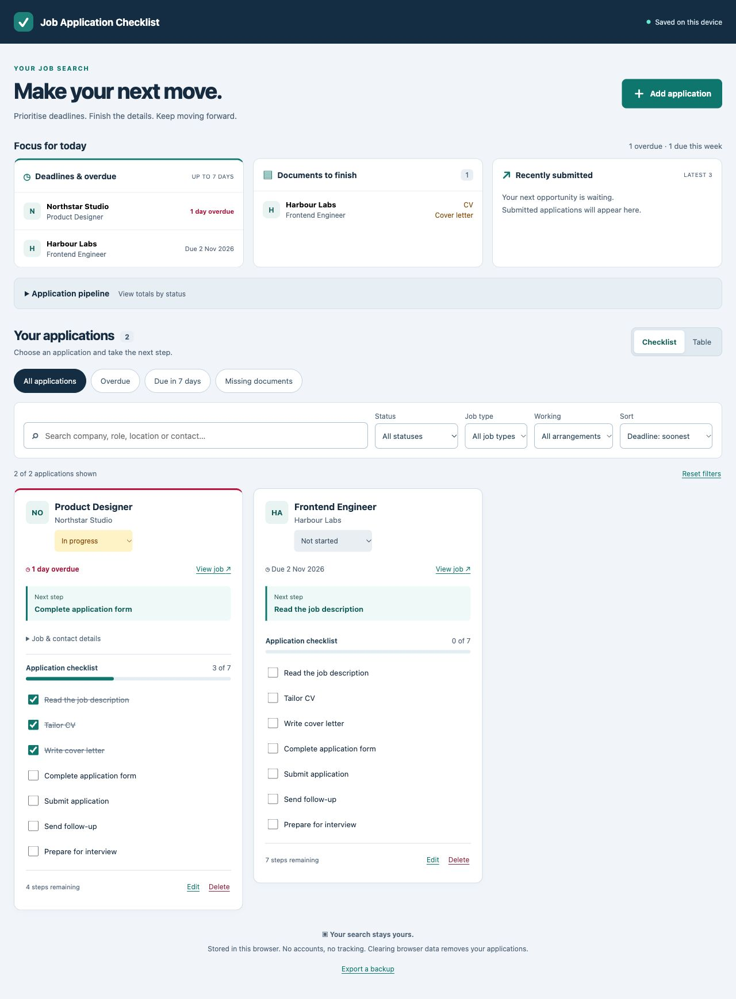
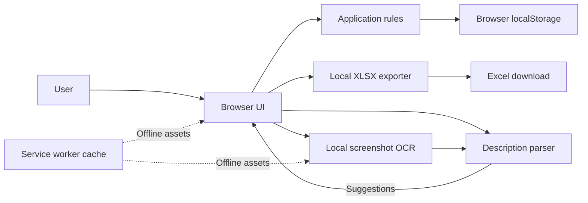

# Job Application Checklist

A browser-only app for tracking job opportunities, deadlines and application checklists. Select **Add application** to enter details or expand the job-description option to paste English text or choose a screenshot. Review suggested fields before saving.

## Screenshots

Fictional examples, captured from the running app.



[Mobile layout](docs/screenshots/mobile.png) · [Job-description prefill](docs/screenshots/prefill.png)

Use priority filters to find overdue jobs, upcoming deadlines or missing documents. Expand **Application pipeline** for status totals. Each checklist suggests a next step appropriate to the application's current stage.

## Run locally

Requires Node.js 22 or newer. No package installation or build is needed.

```sh
git clone https://github.com/SadaqueKhanProjects/job-application-checklist-web-app.git
cd job-application-checklist-web-app
npm start
```

Open [http://127.0.0.1:4173](http://127.0.0.1:4173). The terminal displays the local URL; leave it running and press `Ctrl+C` to stop. Use the same browser and address to see your saved applications. Opening `index.html` directly is unsupported.

## Export to Excel

Choose **Export all to Excel** beside the application view controls. The `.xlsx` download contains:

- **Applications:** all saved jobs, including status, stage, dates, salary, contacts, deadline and clickable job link.
- **Checklist:** each job's seven tasks, marked Done or To do.

Both sheets have filters and frozen headers. Dropdowns and deadline highlighting help when reviewing the file in Excel. All applications are included, even when the app is filtered. Progress and next steps are snapshots at export; Excel edits do not sync back. The file includes contact details and is unencrypted. Export runs locally without extra services or dependencies.

## Commands

Run from the project directory:

| Command | Purpose |
| --- | --- |
| `npm start` | Start the local preview server. |
| `npm test` | Run the automated tests. |
| `npm run check` | Check JavaScript syntax. |

See [CONTRIBUTING.md](CONTRIBUTING.md) for branches, PRs and CI.

## Cost

The app, local OCR and local tests use free tools without paid services. GitHub-hosted CI on a private repository uses the account's shared included allowance; additional usage can be billed unless an effective spending block is in place. CI may stop when that allowance is exhausted. See [GitHub Actions billing](https://docs.github.com/en/actions/concepts/billing-and-usage) and the project's [free-only guidance](AGENTS.md).

## Architecture



The UI validates and stores applications on the device. The local OCR engine reads screenshots; its text is parsed into suggestions that you can edit. The preview server serves static files only.

## Data and privacy

- Data stays in this browser profile and is not encrypted or synced. Clearing site data or using a different browser or address can remove or hide it.
- JSON export is unencrypted. **Import is not implemented**, so keep your own copy of important information.
- Screenshot OCR and text parsing run locally. The screenshot and description are not saved with the application. Review suggestions: the parser may miss fields or leave ambiguous dates blank.
- Offline use requires the browser to cache the app and OCR assets after a successful initial load on localhost or HTTPS. Close older app tabs and reload online after an upgrade.

See [Data and storage](docs/data-and-storage.md) for status behaviour, storage and migrations, and [OCR assets](vendor/ocr/README.md) for bundled components and licences.
