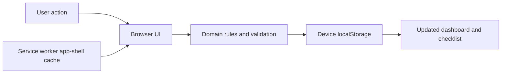

# Job Application Checklist

A browser-only workspace for keeping job applications moving. Add an opportunity, complete its checklist, and keep deadlines and outstanding documents visible. No account, application backend, analytics or remote fonts. Screenshot OCR is bundled locally.

## Run locally

Requires Node.js 22 or newer (verified with Node 24.1.0). No dependency installation or compilation is needed.

```sh
git clone https://github.com/SadaqueKhanProjects/job-application-checklist.git
cd job-application-checklist
npm start
```

Open http://127.0.0.1:4173 in your browser. Use the same browser and address each time to access the same data. Keep the terminal running for first access. `Ctrl+C` stops the preview server; it only serves static files and never receives application data. An initial successful load caches the app for subsequent offline reloads in browsers supporting service workers on localhost or HTTPS. Opening `index.html` directly with `file://` is unsupported.

```sh
npm test
npm run check
```

The source is the release artifact. There is no bundling or package installation step and no remote deployment configured. The bundled OCR components and their licences are listed in [vendor/ocr/README.md](vendor/ocr/README.md). To serve it elsewhere later, use a dedicated HTTPS static origin and these same files.

## Development workflow

See [CONTRIBUTING.md](CONTRIBUTING.md) for issue-numbered branches, scoped Conventional Commits, pull requests and merge rules. [GitHub Actions](.github/workflows/validate.yml) runs syntax checks and tests on Node 22 and 24 for pull requests and main pushes.

## How it behaves

- Company, role, calendar deadline and HTTP(S) job link are required. Applications can be edited or deleted with confirmation.
- In Add application, expand **Fill details from a job description or screenshot**. Paste English text and select **Fill empty fields**, or choose a PNG, JPEG or WebP image (up to 10 MB), or paste a screenshot into the text box. Screenshot text is read locally and suggestions are filled automatically. Review and correct the form before saving; missing or ambiguous values stay empty. The parser handles common labelled fields and some job-board headings, not every advert layout. It does not infer submission status or application dates. Date strings such as `05/06/2027` are left for manual entry because their month/day order is ambiguous.
- The screenshot and pasted/recognised description are not saved with the application or sent elsewhere. Only the fields you choose to save are kept. Tesseract.js, its English OCR model and browser runtime are included locally (about 14 MB); no external OCR service is used. First loading the app caches these assets for offline use when the browser permits it. After upgrading, close older app tabs and reload while online to activate the new cache.
- Optional details: location, employment type (Full-time, Part-time, Contract, Internship, Freelance), work arrangement (Onsite, Hybrid, Remote), salary/rate, contact details, date applied and stage reached. Suggestions for company and location come only from your saved applications. Salary/rate is free text so currency, ranges and annual/day/hour units stay explicit. Contact details are plain text and are never contacted automatically.
- Switch between checklist cards and a horizontally scrollable tracker table. Both edit the same records. Search covers company, role, location, stage and contact; combine it with status, job type and work arrangement filters. Sort by deadline, creation date, company or date applied. View and filter selections reset on reload.
- All seven checklist steps remain available at every stage. The first checked step starts progress. Checking Submit application marks an active application Submitted; unchecking it while Submitted returns it to In progress.
- Statuses are Not started, In progress, Submitted, Awaiting response, Assessment, Interview, Offer, Offer accepted, Rejected and Withdrawn. Choosing a submitted/later live stage checks Submit application, records the first submission timestamp and fills Date applied if blank. Correct the calendar date in the editor when logging an earlier application; future dates are rejected by the form. Moving back to Not started or In progress clears the submission timestamp, Date applied and submission checkbox. Rejected and Withdrawn retain existing submission history.
- Stage reached is a separate optional field. It is never guessed or cleared by status changes: an application can be Rejected with Final interview retained. Choose a suggested stage or enter your own wording.
- Due soon includes active applications due within seven calendar days **and overdue items**, ordered earliest first. Past deadlines are highlighted only for Not started and In progress applications. Deadlines use the device's local date, including today and tomorrow.
- Missing documents means an active application whose Tailor CV or Write cover letter step is incomplete. This version tracks completion, not files.
- Recently submitted shows the three latest Date applied values, including applications that have moved into later stages. Correcting Date applied updates this ordering without changing the original internal submission timestamp. Status totals always count all applications; search and filters affect the cards/table. Selecting a status total clears the other filters.

## Data and recovery

Applications belong to this browser's local storage at this origin under `job-application-checklist.v1`. Nothing is sent to an external service. Application and contact details are not encrypted or synced. Other users of the same browser profile can access it. Private browsing, clearing site data, changing ports/domains or using another browser can remove or hide it.

Export a backup downloads a versioned, readable JSON file to your browser's configured download location. Backup **import is not implemented**; preserve exports for manual recovery or a future import feature. Do not treat browser storage as your only copy of important information.

Saving happens before a UI change is accepted. Failed writes keep the previous in-memory state and display a retry message. Unreadable or incompatible saved data blocks writes and preserves the original value; restore storage access or recover the original data before reloading. A second tab's storage changes refresh the list and close an open editor to reduce stale overwrites; simultaneous multi-tab writes are not transactional.

The current envelope is `{ version: 2, applications: [...] }`. The original local storage key remains `job-application-checklist.v1` for compatibility. Version 1 records are validated and upgraded in memory with blank optional fields and a Date applied derived from an existing submission timestamp. Reading never writes or resets storage; the next successful user save writes version 2. IDs, original fields, checklist progress and timestamps are preserved. Keep older tabs closed during an upgrade; old versions cannot read the new envelope.

Records add optional `location`, `jobType`, `workMode`, `salary`, `contact`, `stageReached` and `appliedOn` to the original ID, company, title, deadline, link, status, seven checklist booleans, creation time and nullable submission time. Calendar dates use `YYYY-MM-DD`. Unknown schemas, malformed records and duplicate IDs block writes. Keep task ordering stable; future schema changes must validate and migrate existing records before writing. Never silently reset incompatible data.

## Structure

```text
index.html          Accessible app shell and modal forms
src/app.js          Rendering, interactions and persistence error feedback
src/domain.js       Checklist rules, date logic and storage validation
src/description-parser.js  Local job-description field suggestions
vendor/ocr/         Locally bundled OCR worker, browser engines, model and licences
src/styles.css      Responsive desktop and mobile layouts
sw.js               Offline app-shell cache (no application data)
scripts/serve.js    Loopback-only static preview server
tests/              Domain/storage rules and static-server checks
```



## Verification and scope

Automated checks cover job-description parsing and ambiguous dates, date/DST boundaries, URL validation, document eligibility, status/checklist transitions, storage round trips, version 1 migration without overwriting source storage, optional metadata validation, invalid schema preservation, write failures, combined filtering/sorting and serving app assets. Desktop in-app browser checks covered creation, editing, overdue display, document completion, submission transitions, search, reload persistence and reloading with the server stopped. Native controls, visible labels, focus indicators, dialog focus handling and reduced-motion styling are included. The tracker update was checked with synthetic data for existing-record preservation, optional details, status/stage independence, table controls, combined filters, new-field search and reload persistence. A 390px browser frame was used to inspect the responsive editor; this is not a physical-device test. For description prefill, desktop browser testing used synthetic pasted text and a synthetic screenshot; screenshot OCR and pasted text were also exercised after stopping the local server and reloading from the offline cache. Clipboard-image paste itself, physical mobile devices and a full assistive-technology audit have not been tested.

This version leaves reminders, document uploads, interview notes, CV libraries, analytics, calendar integrations, cross-device accounts and backup import for later. Source is maintained in the private GitHub repository. No paid service or deployment has been created.
